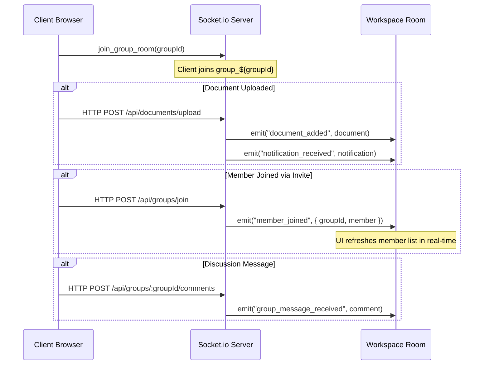

# CollabSpace — MERN Collaborative Document Sharing & Team Workspace

CollabSpace is a full-stack real-time collaborative workspace and document management platform built on the **MERN** stack (MongoDB, Express, React, Node.js). It features multi-method authentication (Passwords, Direct Email OTP, and Google OAuth 2.0), granular Role-Based Access Control (**RBAC**), real-time bidirectional synchronization with **Socket.io**, secure cloud media management via **Multer & Cloudinary**, and a tokenized workspace invitation system.

---

## 🌟 Key Features

### 1. Multi-Method Authentication & User Profiles
- **Direct Email OTP Verification**: Passwordless 6-digit verification code dispatched via Nodemailer (with development console fallback) and automatic profile provisioning.
- **Google OAuth 2.0 Integration**: One-click Google Sign-In powered by `@react-oauth/google` and verified server-side with Google OAuth client libraries.
- **Standard Email & Password**: Secure registration and login using bcrypt password hashing (10 salt rounds) and stateless JWT Bearer authorization.
- **Deep-Link URL Redirection**: Preserves origin URLs (`?redirect=...`) so users who sign in or register via an invitation link return seamlessly to their workspace.
- **Rich Developer Profiles**: Customizable user profiles including Full Name, Job Title, Bio, Avatar URL, Skill Chips, Location, and Phone Number.

### 2. Workspace & Group Management
- **Role-Based Access Control (RBAC)**:
  - **Admin**: Workspace creator or assigned admin with full permissions to manage members, assign roles, delete any document, and generate invites.
  - **Editor**: Allowed to upload files, add comments, and remove documents they uploaded.
  - **Viewer**: Read-only access with permission to preview and download workspace files.
- **Tokenized Workspace Invitations**:
  - **Shareable Join Links**: Unguessable 64-character crypto hex tokens allowing any authenticated team member to join with the designated role.
  - **Direct Email Invitations**: Dispatches email notifications with direct workspace join links.
  - **Public Preview Landing Page (`/join-group?token=...&groupId=...`)**: Public endpoint allowing guests to inspect workspace name, description, inviter, and role before logging in.
  - **Idempotent Acceptance**: Re-clicking or refreshing safely detects existing membership (`alreadyMember: true`).

### 3. Document Management & Cloudinary Integration
- **Hybrid Storage Architecture**:
  - **Local Multer Storage**: Validated temporary disk storage with 20MB file limits and strict MIME-type filters (PDF, DOCX, JPEG, PNG, WEBP).
  - **Cloudinary Integration**: Automated asynchronous upload utility (`uploadOnCloudinary`) that uploads assets to Cloudinary and cleans up local temporary files.
- **Granular Permissions & Deletion**: Non-admins can only delete files they uploaded; Admins have full moderation control.
- **Direct Downloads**: Direct secure file downloads with original filenames and extensions.

### 4. Real-Time Collaboration & Sockets (Socket.io)
- **Document Activity Broadcasts**: Instant workspace notification when a member uploads or removes a document.
- **Live Team Discussions**: Real-time group chat and comments thread (`group_message_received`).
- **Live Member Join Events**: When a new member accepts an invite link, all connected workspace members see the updated member list immediately without refreshing (`member_joined`).
- **Persistent Notification Center**: In-app notifications stored in MongoDB with unread badge counters and 1-click "mark all as read".

---

## 🏗️ Technology Stack

| Domain | Technologies & Libraries |
| :--- | :--- |
| **Frontend** | React 18, Vite, React Router v6, Tailwind CSS, Axios, `@react-oauth/google`, Lucide Icons |
| **Backend** | Node.js, Express.js, Socket.io, Mongoose (MongoDB ODM), JSON Web Tokens (JWT), Bcrypt.js |
| **Storage & Uploads** | Cloudinary SDK, Multer disk storage |
| **Mailing / OTP** | Nodemailer (SMTP transport with automated development console fallback) |
| **Database** | MongoDB (Local or MongoDB Atlas) |

---

## 📁 Project Structure

```text
practice1/
├── package.json                      # Monorepo root scripts
├── server/
│   ├── config/
│   │   ├── db.js                     # MongoDB connection
│   │   ├── cloudinary.js             # Cloudinary v2 configuration
│   │   └── emailService.js           # Nodemailer OTP & Workspace invite mailer
│   ├── controllers/
│   │   ├── authController.js         # Register, Login, Google OAuth, Email OTP
│   │   ├── groupController.js        # Workspace CRUD, Invites, Public Preview, Join
│   │   ├── documentController.js     # Upload, List, Delete, Cloudinary sync
│   │   └── notificationController.js # Read, Unread counters, Notification sync
│   ├── middleware/
│   │   ├── authMiddleware.js         # JWT verification & User extraction
│   │   ├── rbacMiddleware.js         # Workspace role permissions (Admin/Editor/Viewer)
│   │   ├── multer.middleware.js      # Multer temporary file disk storage
│   │   └── uploadMiddleware.js       # File size and MIME-type validator
│   ├── models/
│   │   ├── User.js                   # Profile, Password hashing, Auth types
│   │   ├── Group.js                  # Workspaces, Member roles, Crypto invite tokens
│   │   ├── Document.js               # File metadata, Versioning hooks, Cloudinary URLs
│   │   ├── Notification.js           # Persistent user notification schema
│   │   └── Comment.js                # Workspace discussions & chat
│   ├── routes/
│   │   ├── authRoutes.js             # /api/auth endpoints
│   │   ├── groupRoutes.js            # /api/groups endpoints
│   │   ├── documentRoutes.js         # /api/documents endpoints
│   │   ├── notificationRoutes.js     # /api/notifications endpoints
│   │   └── upload.routes.js          # /api/v1/upload Cloudinary endpoint
│   ├── sockets/
│   │   └── chatSocket.js             # Socket.io room handlers & real-time events
│   ├── uploads/                      # Local storage directory
│   ├── .env.example                  # Backend environment template
│   └── server.js                     # Express app + Socket.io server bootstrapper
└── client/
    ├── src/
    │   ├── api/axiosInstance.js      # Axios instance with JWT interceptor
    │   ├── components/
    │   │   ├── common/               # Navbar, ProtectedRoute, GoogleAuthButton
    │   │   ├── documents/            # DocumentList, UploadModal, PreviewModal
    │   │   ├── groups/               # InviteMemberModal, MemberCard, WorkspaceHeader
    │   │   └── notifications/        # NotificationDropdown, NotificationBell
    │   ├── context/
    │   │   ├── AuthContext.jsx       # Global Auth state, OTP, Google Auth, Logout
    │   │   └── SocketContext.jsx     # Socket.io connection provider
    │   ├── pages/
    │   │   ├── Dashboard.jsx         # My Workspaces, Quick Actions, Stats
    │   │   ├── GroupDetail.jsx       # Workspace files, Team chat, Member management
    │   │   ├── JoinGroup.jsx         # Public Invitation preview & Join flow
    │   │   ├── Profile.jsx           # User profile editor
    │   │   ├── Login.jsx             # Password & Email OTP Sign-in
    │   │   └── Register.jsx          # New user registration
    │   ├── App.jsx                   # Application Routes & OAuth wrapper
    │   └── index.css                 # Tailwind CSS directives
    ├── .env                          # Frontend environment variables
    ├── tailwind.config.js
    └── vite.config.js
```

---

## ⚙️ Environment Configuration

### Backend: `server/.env`

Create a file named `.env` in the `server/` directory:

```env
PORT=5000
MONGO_URI=mongodb://localhost:27017/mern_collab_db
JWT_SECRET=your_super_secret_jwt_key_here
CLIENT_URL=http://localhost:5173

# Cloudinary Setup (From console.cloudinary.com -> Dashboard -> API Keys)
CLOUDINARY_CLOUD_NAME=your_cloudinary_cloud_name
CLOUDINARY_API_KEY=your_cloudinary_api_key
CLOUDINARY_API_SECRET=your_cloudinary_api_secret

# Google OAuth 2.0 (From console.cloud.google.com -> Credentials -> OAuth 2.0 Client IDs)
GOOGLE_CLIENT_ID=your_google_client_id_here
GOOGLE_CLIENT_SECRET=your_google_client_secret_here

# Optional: SMTP Email Service (Falls back to terminal console output if omitted)
SMTP_HOST=smtp.gmail.com
SMTP_PORT=587
SMTP_USER=your_email@gmail.com
SMTP_PASS=your_app_password
SMTP_FROM="CollabSpace" <no-reply@collabspace.com>
```

### Frontend: `client/.env`

Create a file named `.env` in the `client/` directory:

```env
VITE_API_URL=http://localhost:5000/api
VITE_SOCKET_URL=http://localhost:5000
VITE_SERVER_URL=http://localhost:5000

# Google OAuth Client ID (Optional for Google Sign-in button)
VITE_GOOGLE_CLIENT_ID=your_google_client_id_here
```

---

## 🚀 Getting Started Locally

### 1. Clone & Install Dependencies

From the project root:
```bash
# Install root, backend, and frontend packages
npm run install:all
```
*(Or install manually inside both `server/` and `client/`: `cd server && npm install && cd ../client && npm install`)*

### 2. Start MongoDB
Ensure MongoDB is running locally on port `27017` or update `MONGO_URI` to point to a MongoDB Atlas cluster:
```bash
mongod --dbpath <path_to_data>
```

### 3. Run Development Servers

**Option A — Separate Terminals:**
```bash
# Terminal 1: Start Backend (Port 5000)
cd server
npm run dev

# Terminal 2: Start Frontend (Port 5173)
cd client
npm run dev
```

**Option B — Root Commands:**
```bash
# Start backend from root
npm run server

# Start frontend from root
npm run client
```

Open your browser at **`http://localhost:5173`**.

---

## 📡 API Reference

### 1. Authentication (`/api/auth`)
| Method | Endpoint | Description | Access |
| :--- | :--- | :--- | :--- |
| `POST` | `/api/auth/register` | Register new account with profile | Public |
| `POST` | `/api/auth/login` | Authenticate with email & password | Public |
| `POST` | `/api/auth/send-otp` | Send 6-digit verification code to email | Public |
| `POST` | `/api/auth/verify-otp` | Verify OTP and authenticate / provision user | Public |
| `POST` | `/api/auth/google` | Verify Google OAuth ID token & authenticate | Public |
| `GET` | `/api/auth/profile` | Get logged-in user profile | Protected |
| `PUT` | `/api/auth/profile` | Update user profile fields | Protected |

### 2. Workspaces & Groups (`/api/groups`)
| Method | Endpoint | Description | Access |
| :--- | :--- | :--- | :--- |
| `GET` | `/api/groups/invite-info` | Preview workspace details via invite token | **Public** |
| `POST` | `/api/groups` | Create workspace (Creator becomes Admin) | Protected |
| `GET` | `/api/groups` | Get all workspaces current user belongs to | Protected |
| `GET` | `/api/groups/:groupId` | Get workspace details, documents & members | Workspace Member |
| `POST` | `/api/groups/:groupId/invite`| Generate shareable link or email invite | Workspace Admin |
| `POST` | `/api/groups/join` | Accept invitation token and enter workspace | Protected |
| `PUT` | `/api/groups/:groupId/members/:userId` | Update member role (`Viewer`/`Editor`/`Admin`) | Workspace Admin |
| `GET` | `/api/groups/:groupId/comments` | Fetch discussion messages | Workspace Member |
| `POST` | `/api/groups/:groupId/comments`| Send discussion message | Workspace Member |

### 3. Documents (`/api/documents`)
| Method | Endpoint | Description | Access |
| :--- | :--- | :--- | :--- |
| `POST` | `/api/documents/upload` | Upload document to workspace & notify | Admin / Editor |
| `GET` | `/api/documents/group/:groupId` | Get all documents for a workspace | Workspace Member |
| `DELETE`| `/api/documents/:id` | Delete document | Admin or File Uploader |

### 4. Cloudinary Uploads (`/api/v1/upload`)
| Method | Endpoint | Description | Access |
| :--- | :--- | :--- | :--- |
| `POST` | `/api/v1/upload` | Upload single file to Cloudinary | Protected |

### 5. Notifications (`/api/notifications`)
| Method | Endpoint | Description | Access |
| :--- | :--- | :--- | :--- |
| `GET` | `/api/notifications` | Get user notifications & unread count | Protected |
| `PUT` | `/api/notifications/read-all` | Mark all notifications as read | Protected |
| `PUT` | `/api/notifications/:id/read` | Mark single notification as read | Protected |

---

## 🔄 Real-Time Socket.io Events



---

## 🛡️ Role-Based Access Control (RBAC) Matrix

| Feature | Admin | Editor | Viewer |
| :--- | :---: | :---: | :---: |
| **View & Download Workspace Documents** | ✅ | ✅ | ✅ |
| **View Team Discussion & Members** | ✅ | ✅ | ✅ |
| **Post Discussion Comments** | ✅ | ✅ | ✅ |
| **Upload Files & Documents** | ✅ | ✅ | ❌ |
| **Delete Own Uploaded Files** | ✅ | ✅ | ❌ |
| **Delete Any Member's Files** | ✅ | ❌ | ❌ |
| **Generate Shareable & Email Invite Links** | ✅ | ❌ | ❌ |
| **Change Member Roles** | ✅ | ❌ | ❌ |

---

## 🧪 Testing Verification
- **E2E Invite & Membership Flow**: Tested invite link generation, unauthenticated preview, multi-account acceptance, duplicate prevention, and real-time socket events.
- **Client Production Build**: Verified with `npm run build` using Vite v6 with 0 errors.
